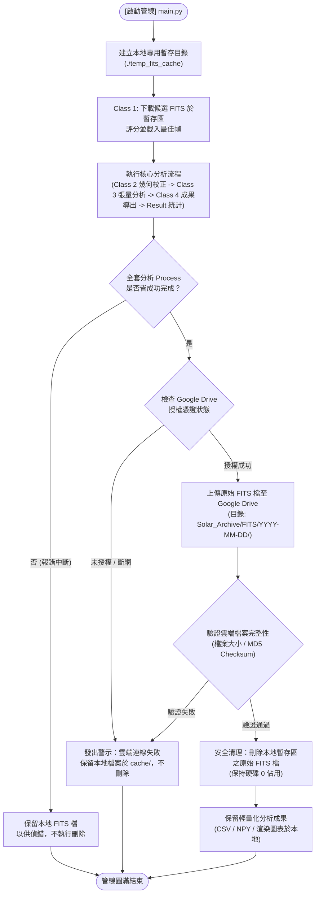
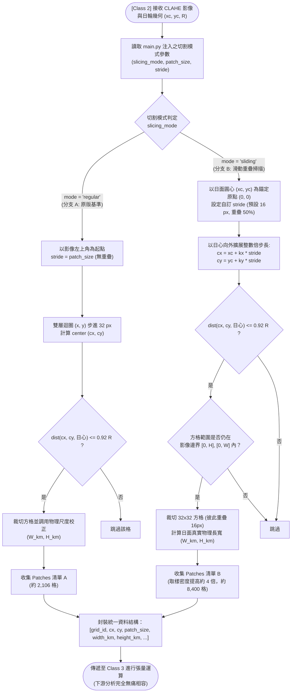

# 全日面太陽分析系統擴充功能規格與邏輯架構說明書

本文件整理自針對系統兩大外加功能之詳細規劃與技術規格論證，包含**Google Drive 雲端儲存與本地暫存自動清理機制**以及**日心錨定滑動掃描式重疊切割（雙軌分支）**。

---

# 外加功能一：Google Drive 雲端存放與本地暫存自動清理機制

### 1. 核心需求分析與設計理念
* **問題背景**：全日面高解析度 FITS 檔（單幀解壓縮後約 8~16 MB，若大量檢索易累積數 GB），長期存放會佔用本地寶貴硬碟空間。
* **運作策略（Local Cache & Cloud Archive）**：
  1. **本地臨時暫存（Scratch Buffer）**：在 Class 1 進行資料檢索與評分時，將 FITS 下載至專用暫存區（如 `./temp_fits_cache/` 或系統暫存目錄）。
  2. **端到端流程不中斷**：本地硬體完成 Class 1 到 Class 4 及 Result 的完整分析後，生成所有特徵 CSV、NPY 與圖像。
  3. **非阻塞/確認式雲端同步**：將原始 FITS 壓縮檔安全上傳至 Google Drive 指定的雲端資料夾（如 `Solar_Archive/FITS/YYYY-MM/`）。
  4. **校驗安全清理（Fail-Safe Purge）**：**必須在雲端回傳上傳成功確認（MD5 Checksum 或檔案大小驗證一致）後**，才執行本地 FITS 原始檔的刪除，確保科學原始資料絕不意外遺失。若斷網或上傳失敗，則保留本地暫存並輸出警告。

---

### 2. Google Drive 模組架構與資料流邏輯圖



---

# 外加功能二：雙軌分支「滑動掃描式重疊切割 (Sliding-Window Scan)」

### 1. 核心需求分析與雙軌比較價值
* **原版切割法（Branch A: Regular Grid 切割）**：
  * **方式**：由影像左上角 $(0, 0)$ 開始，以無重疊步長（$\text{stride} = \text{patch\_size} = 32\text{ px}$）平鋪日面。
  * **特性**：方格邊緣不重疊，計算速度快，但網格起點未對齊日心，且方格邊界處的細絲會被硬性截斷，在二維拓撲圖上會產生微弱的網格效應（Grid Artifacts）。
* **新版掃描法（Branch B: Center-Anchored Sliding Scan 滑動重疊切割）**：
  * **日心錨定（Center-Anchored）**：不再從左上角盲目切割，而是**以太陽盤面日心 $(x_c, y_c)$ 為絕對幾何原點 $(0, 0)$**。
  * **步長位移調控（Stride Control）**：步長設為 $\text{stride} = 16\text{ px}$，方格大小維持 $\text{patch\_size} = 32\text{ px}$。
  * **50% 空間過取樣（Nyquist Spatial Overlap）**：相鄰方格在 X 與 Y 方向各自具備 $50\%$ 的重疊率。
  * **雙軌共存比對價值**：
    1. **細絲邊界連續性**：原本恰巧落在方格邊緣而被削弱同調度 $C$ 的暗條，在滑動掃描中會被鄰近重疊的方格完整包覆，大幅提升纖維追蹤的連續度。
    2. **空間解析密度提升 4 倍**：採集點密度為原本的 4 倍（$\Delta x = 16, \Delta y = 16$），二維拓撲圖將呈現極高平滑度的色球磁流場走勢。
    3. **便於科學比較**：保留原版程式碼為分支 A，新版為分支 B，可直接產出兩組 CSV/影像進行精確對照。

---

### 2. 滑動掃描之數學座標模型

設日心為 $(x_c, y_c)$，日輪有效半徑為 $R_{\text{disk}} = 0.92 R$：
1. **網格點生成**：
   $$k_x \in \left[ -\left\lfloor \frac{R_{\text{disk}}}{\text{stride}} \right\rfloor, \dots, 0, \dots, \left\lfloor \frac{R_{\text{disk}}}{\text{stride}} \right\rfloor \right]$$
   $$k_y \in \left[ -\left\lfloor \frac{R_{\text{disk}}}{\text{stride}} \right\rfloor, \dots, 0, \dots, \left\lfloor \frac{R_{\text{disk}}}{\text{stride}} \right\rfloor \right]$$
2. **方格中心點**：
   $$c_x(k_x) = x_c + k_x \times \text{stride}, \quad c_y(k_y) = y_c + k_y \times \text{stride}$$
   * 當 $k_x = 0, k_y = 0$ 時，正好精準落在日心 $(x_c, y_c)$。
3. **有效性檢核**：
   $$\text{dist} = \sqrt{(c_x - x_c)^2 + (c_y - y_c)^2} \le 0.92 R$$
4. **左上角像素裁切索引**：
   $$x = \text{round}(c_x - \text{patch\_size} / 2), \quad y = \text{round}(c_y - \text{patch\_size} / 2)$$

---

### 3. 方格切割雙軌分支邏輯流程圖



---

### 4. 未來在 `main.py` 的參數調控介面規劃

```python
# -------------------------------------------------------------
# main.py 使用者參數調控區 (未來實作預覽)
# -------------------------------------------------------------
# [切割分支切換]
slicing_mode = "sliding"     # "regular" (原版無重疊) 或 "sliding" (新版滑動掃描)
patch_size   = 32            # 方格大小 (像素)
stride       = 16            # 滑動步長 (像素，僅在 sliding 模式生效；16 即 50% 重疊)

# [雲端儲存與暫存清理]
enable_gdrive_sync = True    # 是否在分析完成後將 FITS 備份至 Google Drive
clean_local_fits   = True    # 備份成功後是否自動釋放本地硬碟 (刪除本地暫存 FITS)
gdrive_folder_id   = "..."   # 目標 Google Drive 資料夾 ID
```

